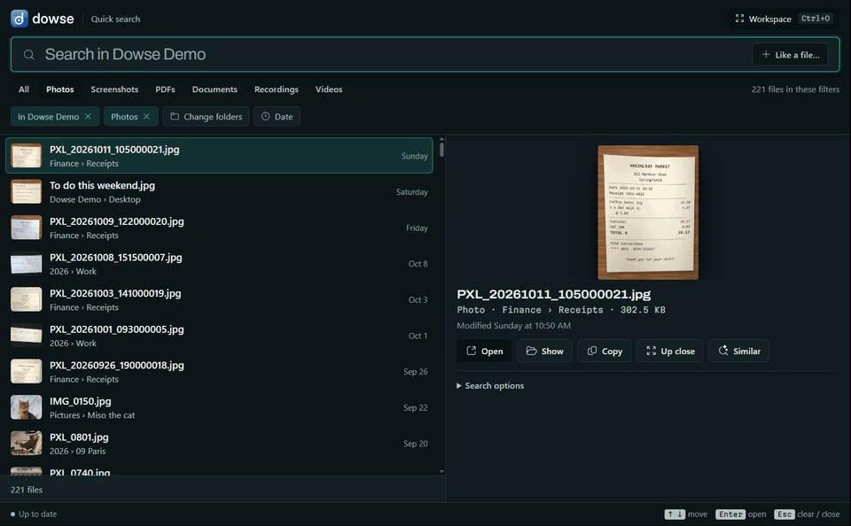
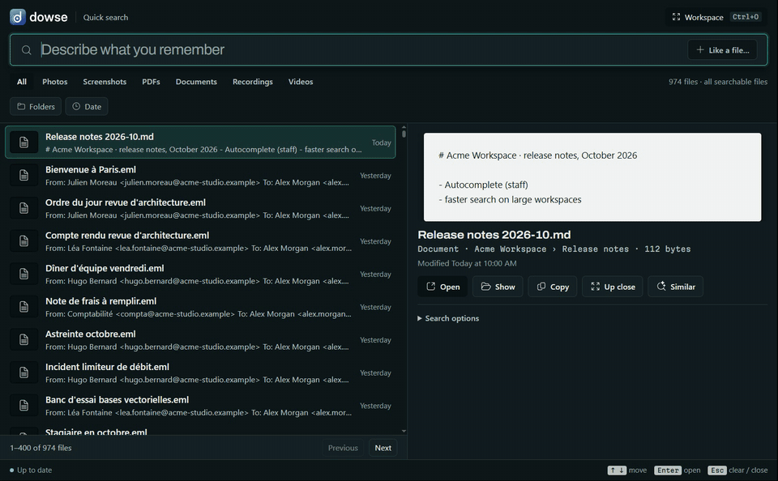
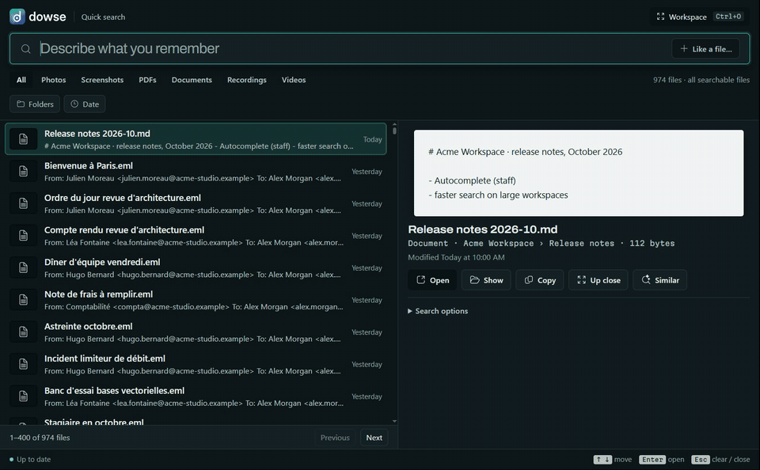
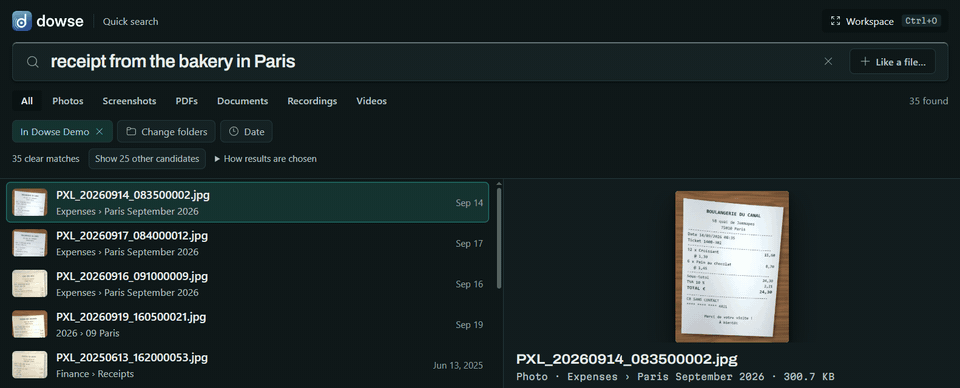
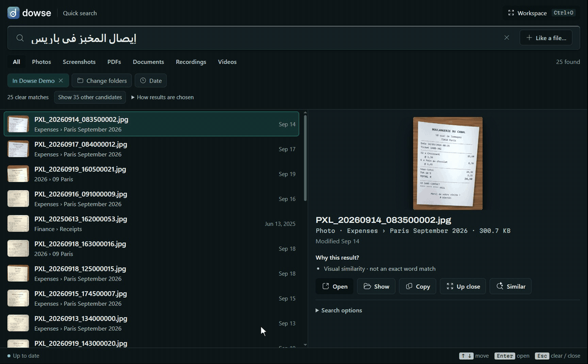
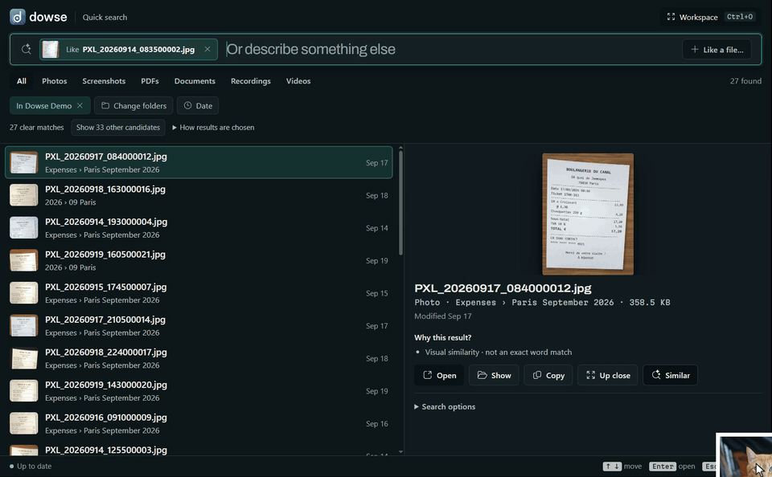
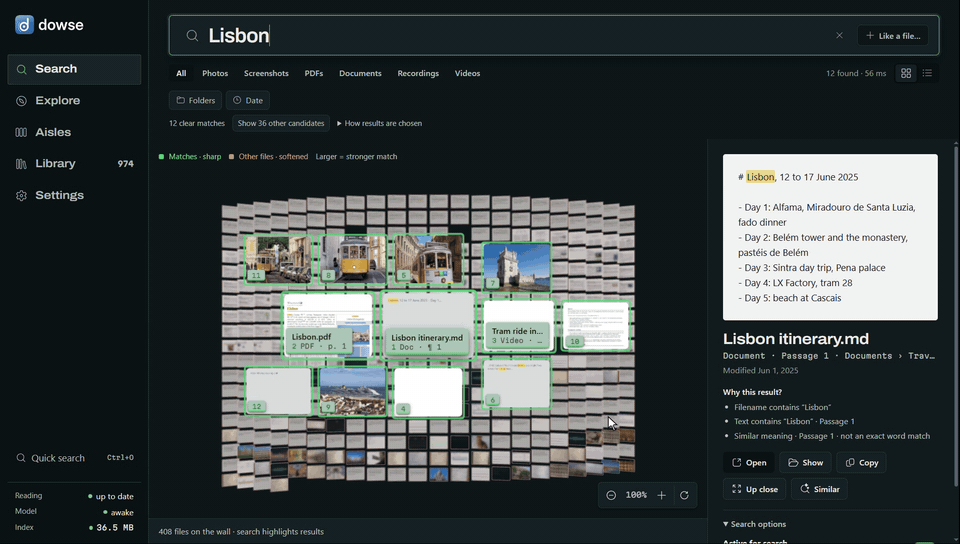
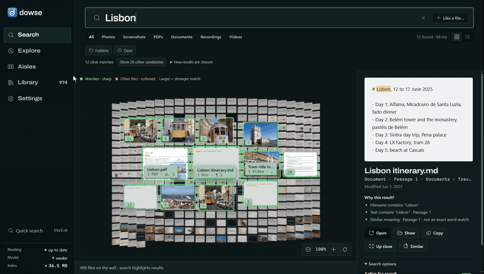

<p align="center"></p>

<p align="center"><b>Find anything on your PC by what's in it.</b></p>

<p align="center">Windows · runs on your PC, nothing uploaded · photos, screenshots, PDFs, documents, recordings and videos ·
100+ languages</p>

<p align="center"></p>

Your files are named `IMG_0011.jpg`, `PXL_20260914_083500002.jpg` and `Recording 3.m4a`, and Windows search only looks at
names. Dowse looks at what's in them. Describe what you remember, in your own words, and it finds the file:

- a photo by what it shows: *"photos of a yellow tram in Lisbon"*;
- a document by what it says, open at the page: *"can I keep a dog in the flat"* finds the lease's pets clause;
- a recording or a video by what's said or seen, at that moment: *"how many months for an emergency fund"* finds the
  podcast at 0:25, where it's said;
- in any language, whatever the file's language: *"إيصال المخبز في باريس"* (Arabic) finds the phone photo of a Paris
  bakery receipt.

It runs [EmbeddingGemma 2](https://huggingface.co/google/embeddinggemma-2), Google DeepMind's open multimodal embedding
model, locally through [llama.cpp](https://github.com/ggml-org/llama.cpp): on your graphics card when you have one
worth using, on the processor otherwise. Your files are read and searched on your PC. Dowse goes online only to
download its model and runtime, once.

## What it does

| | |
|---|---|
| **Describe it** | Alt+Shift+Space from any app, type what you remember. Results come as you type. |
| **Goes to the spot** | A PDF opens at the page with your words marked; a recording or video plays from the moment. |
| **Music tags** | Find songs by embedded artist, title, album or genre—even when their filenames say nothing. |
| **Every kind of file** | Photos (HEIC too), screenshots (with their words, via Windows OCR), PDFs, Word/PowerPoint/Excel and OpenDocument, notes, e-mails, e-books, code, recordings and videos. |
| **Any language** | Search in one language, find files written in another. |
| **More like this** | Start from a file: *Similar* on any result, or drop a photo on the window. |
| **Explore** | Your files laid out by what's in them, grouped into aisles you can name and shape. |
| **Always up to date** | New, changed, moved and deleted files are followed live. |
| **Yours** | Choose folders, single files from anywhere, or new screenshots; switch anything off; encrypt the index. |

## See it

**Inside documents, at the right page.** Ask it as you'd ask a person; the lease comes first, and up close it's the
page with the pets clause.

<p align="center"></p>

**Sound and video, at the moment.**

<p align="center"></p>

**Any language.** One receipt, searched for in 13 languages. It comes first every time.

<p align="center"></p>

**More like this.** From a receipt, its siblings. From a photo Dowse has never seen, the ones like it (the dropped
file is read to compare, never added).

<p align="center">
</p>

**The Workspace.** The same search as a gallery: the closest files come forward; zoom in, drag around.

<p align="center"></p>

**Explore.** Zoom out to every topic, step into one.

<p align="center"></p>

## Performance

Measured with [`scripts/benchmark.py`](scripts/benchmark.py) on the library in the GIFs, a demo PC of made-up files (974 files, 548 MB), read from scratch. One PC: AMD Ryzen 9 7900X (12 cores), 32 GB, NVIDIA GeForce RTX 4070 Ti, Windows 10, llama.cpp
b11574. Yours will differ; the script measures your own.

**Reading your files** happens once; after that, only new or changed files are read, seconds after they appear. On
average, one file takes:

| | Graphics card (Vulkan) | Processor only |
|---|---|---|
| A photo | 49 ms | 347 ms |
| A screenshot, with its words (OCR) | 114 ms | 722 ms |
| A PDF (10 pages here on average) | 306 ms · 32 ms a page | 6,996 ms · 725 ms a page |
| A document: Office, notes, e-mails, e-books, code (5 passages here on average) | 58 ms | 1,335 ms |
| A recording (1.7 min here on average) | 336 ms · 202 ms a minute | 4,804 ms · 2,886 ms a minute |
| A video (1.1 min here on average) | 523 ms · 467 ms a minute | 3,700 ms · 3,304 ms a minute |
| **Any file**, in this library's mix | **147 ms** | **2,712 ms** |

So the 974 files took 2 min 27 s on the graphics card and 44 min on the processor alone. Each kind was timed on its
own, the model's start left out; read together, reading and embedding overlap. On a processor Dowse reads pictures
smaller and video frames less often, so it stays usable without a graphics card.

**Searching** on the graphics card (the library's 5,389 vectors; 40 queries, in `scripts/benchmark.py`, three times each):

| | median | 95th percentile |
|---|---|---|
| From typed words to ranked results | **56 ms** | 125 ms |
| of which the query's embedding | 18 ms | 32 ms |

On the processor alone, search is as quick (48 ms median, 126 ms at the 95th percentile): a query is short. It's
reading files that a graphics card speeds up, PDFs and documents most of all.

The search model sleeps after 10 idle minutes; waking it takes 1.6 s, and results from words show meanwhile. A
search compares the query with every vector, so it grows with the library: that pass alone takes 0.15 s for 100,000
vectors (about 18,000 files like these) and 1.5 s for a million, on one core. The index for these 974 files is 36 MB
on disk.

## Install

Dowse needs Windows 10 or 11 (64-bit), about 1 GB of disk for the model and runtime, and Edge WebView2 (part of
Windows; the installer adds it if it's missing). A graphics card is optional: one with 2 GB or more of its own memory
is used through Vulkan (NVIDIA, AMD or Intel; CUDA can be chosen instead), and otherwise everything runs on the
processor. The card actually in the PC is detected; Settings can switch between it and the processor.

**From source** (Python 3.12 or 3.13, [uv](https://docs.astral.sh/uv/), Node 22+ for the interface):

```powershell
git clone https://github.com/WalidHadri-Iron/dowse.git
cd dowse
cd web; npm install; npm run build; cd ..
uv sync
uv run dowse-app          # first run: pick a model, folders, and the shortcut
```

A per-user Windows installer (no admin rights, Inno Setup) is built by `uv run python scripts/build_installer.py`;
releases will be published once it's signed and tested.

## Use it

1. **Choose what it searches.** The first run suggests your usual folders and says how long reading them will take
   on this PC. Later: right-click any file in Explorer › **Dowse** › **Add to Dowse**, turn on **Add new
   screenshots**, or use the **Library**.
2. **Press Alt+Shift+Space** from any app (the shortcut can be changed).
3. **Describe it.** ↑↓ to move, **Enter** opens at the page or moment, **Shift+Enter** looks up close,
   **Ctrl+Enter** shows it in Explorer, **Ctrl+O** opens the Workspace (Search, Explore, Aisles, Library, Settings).

Dates and kinds said plainly are understood: *"electricity bill from March"*, *"photos from Iceland last December"*,
*"the pdf about…"*. When nothing matches, Dowse says so instead of passing off the closest file.

There's a command line too (`dowse index`, `dowse search`, `dowse similar`, `dowse watch`…). The full guide to the
app, its keys and settings, and the CLI is in [docs/using-dowse.md](docs/using-dowse.md).

## How it works

```
your folders ─► readers: pictures, PDF pages, documents' passages, OCR, 30 s windows of sound, video shots
             ─► EmbeddingGemma 2 on llama.cpp (Vulkan, CUDA or CPU): one 768-d vector each, one space for all kinds
             ─► one SQLite file: the vectors (fp16) + a keyword index (FTS5), on your PC
your words   ─► the same model ─► meaning and words ranked together ─► the file, at its page or moment
```

Ranking, the readers, the live watcher, the evaluation sets and their numbers: [docs/how-it-works.md](docs/how-it-works.md).

## Privacy

- Files are read where they are; Dowse never changes, moves, uploads or copies them.
- The index (`%LOCALAPPDATA%\Dowse`) stays on your PC; Settings can encrypt it with your Windows sign-in.
- Network: the model from Hugging Face and the runtime from llama.cpp's GitHub releases, at setup or when you
  switch model or device. Nothing else.
- Keys and password files, OneDrive files that are only online, and code projects' internals are never read.

## Development

```powershell
uv run pytest                                   # engine and app (server tests start llama-server)
cd web; npm run check; npm test; npm run build  # interface
uv run python scripts/benchmark.py D:\Photos --kinds   # the numbers above, on your PC and files
```

More in [docs/development.md](docs/development.md).

## Roadmap

- Releases with a signed installer, and Explorer's Windows 11 first-level menu (it needs a signed package).
- An MCP server, so agents can search your files.
- macOS and Linux.

## License

Dowse is MIT licensed ([LICENSE](LICENSE)). EmbeddingGemma 2 is downloaded from Hugging Face at setup and is used
under the [Gemma Terms of Use](https://ai.google.dev/gemma/terms); llama.cpp is MIT licensed.
